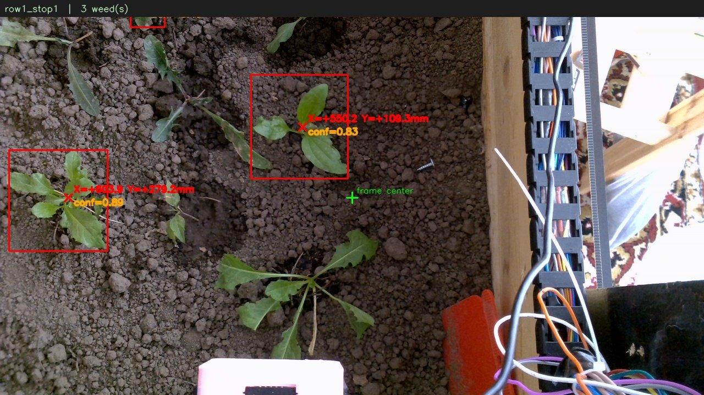

# WeedZap: Laser Weeding Robot

A gantry robot that finds weeds with a camera and a custom YOLO model, then drives a laser over each one to burn it.

## Context

| | |
|---|---|
| **Type** | Personal / team hardware project |
| **Built** | April – August 2026 |
| **Area** | Computer vision · robotics · embedded |

## How it works

1. **Tour.** The gantry sweeps both rows with no tool attached, so the camera can see. At each stop it photographs the bed and asks the firmware for its real position.
2. **Detect.** A YOLO pose model finds each weed and its crown (the point to burn).
3. **Map.** Pixel coordinates become millimetres using a per-height calibration (homography + polynomial fit), plus a measured camera-to-laser offset.
4. **Zap.** The gantry picks up the laser tool once, then visits every recorded weed and fires.

## Results

| YOLO weed detection | Gantry camera, model test |
|---|---|
|  |  |

| Path planning between weeds | Calibration fit residuals |
|---|---|
|  |  |

## Project structure

| Folder | What's inside |
|---|---|
| `scripts/` | `weed_zap.py` (full run), `path.py` (pixel → mm and routing), `calibrate.py`, `measure_laser_offset.py`, `test_model.py`, debugging tools |
| `model/` | Trained YOLO weights (`best.pt`, …) |
| `calibration/` | Saved calibration per height + camera-to-laser offset |
| `firmware/` | Arduino / ESP32 gantry firmware |

The branch `the-previous-version-without-cv-model` holds the earlier version, from before the CV model was added.

## Tech

Python · Ultralytics YOLO (pose) · OpenCV · NumPy · Arduino / ESP32 · Raspberry Pi

## What I learned

Training and deploying a detection model on real hardware, camera calibration, and debugging where a robot thinks it is versus where it really is.
